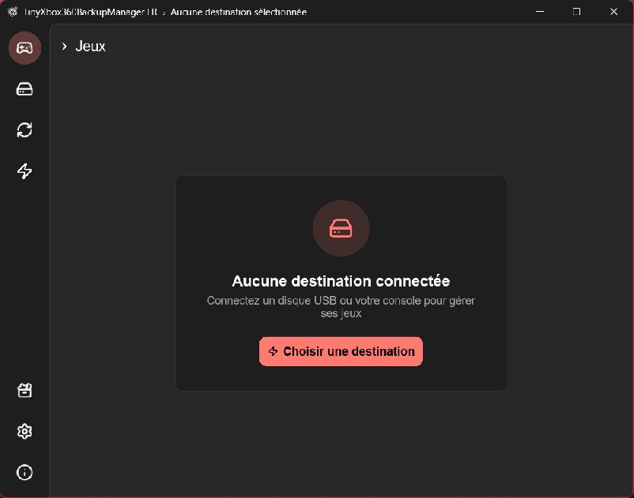
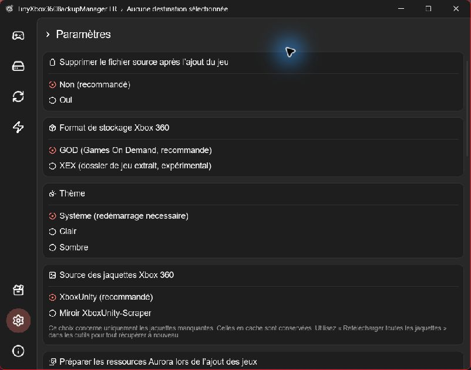

# French translation proposal

This draft contributes French wording for the interface, native file dialogs,
notifications, progress messages and application-owned errors, based on v0.18.0
(`3059f881f9a2bf7a54808cd0478cea4000ea3e8f`).

**This is a French-only prototype, not a language-selection implementation.**
The current patch replaces English literals. Before merging into the default
application, the translations should be integrated with the maintainer's preferred
localization design so English remains available. The JSON catalogs provide
English/French pairs for that integration; they are not loaded at runtime.

## Scope

- 765 English/French catalog entries, with additional contextual adjustments in
  the interface (plural forms, shorter search hint and content-type display).
- Configuration values, sorting identifiers, content types, Xbox paths and FTP
  commands retain their original meanings. Original credits and license remain.
- An absolute `TXBM_FR_DATA_DIR` environment override allows an isolated test
  profile. Without it, the original data directory and single-instance behavior
  are retained.
- A Windows GNU build helper is included. It keeps the required 8 MB stack size;
  `-LlvmWindres` can be used when the source path contains spaces.

The prototype identifies itself as an unofficial French edition. This branding
and the testing helper can be revisited along with the localization design.
Game metadata language is still a separate setting. Game titles, external service
responses and operating-system/library errors can remain in their source language.
Aurora menu names in instructions are retained where needed to find them on the
console.

## Validation

Prepared with AI assistance and checked locally on Windows x64:

- Release build succeeded with Rust 1.97.0, target `x86_64-pc-windows-gnu`,
  WinLibs GCC 16.2.0 / MinGW-w64 UCRT 14.0.0 and LLVM-MinGW 20261020 windres.
- `cargo test --locked --release --target x86_64-pc-windows-gnu -p txbm-core --lib`:
  27 passed, 0 failed. One assertion was updated to expect the French error text.
- `python translation-fr/verify.py`: catalog placeholders and selected protocol
  values checked against the included upstream snapshot. This does not prove
  complete localization coverage or replace compilation and functional tests.
- `git diff --check` passed.
- The resulting executable was opened with an isolated profile; the home screen,
  settings, toolbox, destination selector and About page were visually checked.

No physical Xbox 360, real FTP transfer, FATX write or exploit installation was
tested. Linux and macOS builds have not been tested locally. Compiled executables,
toolchains, private configuration and test profiles are not part of this proposal.

## Screenshots

